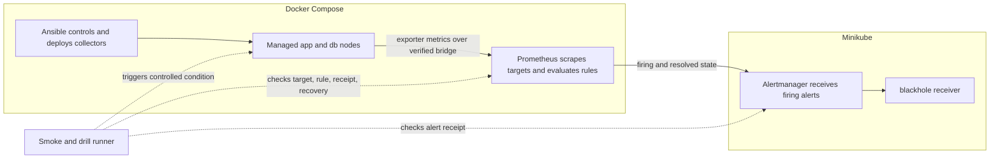

# Runtime evidence

This page summarizes one local execution on 2026-10-16. The private source
timelines live under `.local/evidence/` and are intentionally not published.
The run demonstrates a disposable lab path; it does not establish production
readiness or external notification delivery.

## Signal path

Ansible establishes the controls and collector on the Compose nodes. Prometheus
in Minikube scrapes their exporters over the profile's verified Docker bridge
and evaluates the rules. The local smoke and drill runner triggers controlled
conditions and queries target, alert, receipt, and recovery state. Alertmanager
receipt is observed through its API; the configured receiver is `blackhole`,
so the path proves receipt, not delivery to an external service.

## Drill timeline

All three drills ran against the `app` node with the Docker driver. The table
reports only phase names and outcomes from their private UTC timelines.

| Drill | Injected condition and observed path | Outcome |
| --- | --- | --- |
| `instance-down` | Exporter stopped; `baseline → injected → signal → pending → firing → alertmanager → recovered → resolved` | **PASS** — `InstanceDown` reached Alertmanager and resolved after recovery. |
| `ssh` | Six rejected-key attempts; `baseline → injected → signal → pending → firing → alertmanager → recovered → resolved` | **PASS** — `SSHRejectedAttempts` reached Alertmanager and resolved; the recovery audit completed. |
| `cpu` | Bounded CPU load; `baseline → injected` | **cpu-bounded** — failed closed because the canonical `HighCPUUsage` alert did not complete its firing path. No threshold was lowered and no extra workers were added. |

These outcomes match the documented drill contracts in
[`demo.md`](demo.md) and the signal mapping in
[`control-signal-matrix.md`](control-signal-matrix.md). To reproduce the
execution, follow the prerequisites and ordered commands in
[`demo.md`](demo.md); a new run writes fresh private evidence under
`.local/evidence/`.

## Route restriction

A negative-origin check ran the same day. The first run found that foreign
Docker networks on this host reached the published ports, so the "firewall
restricted to Minikube" prerequisite was not enforced. After the host firewall
was restricted (INPUT rule for the proxy path plus a DOCKER-USER rule on the
post-DNAT ports), the re-test passed: the bind listens only on the
profile-network gateway, the host LAN address refuses, foreign Docker networks
time out, the Minikube node keeps reaching all three ports and Prometheus
targets stay `up`. Persist the rule across reboots. Remaining publication
gates are tracked in
[`publication-checklist.md`](publication-checklist.md).
